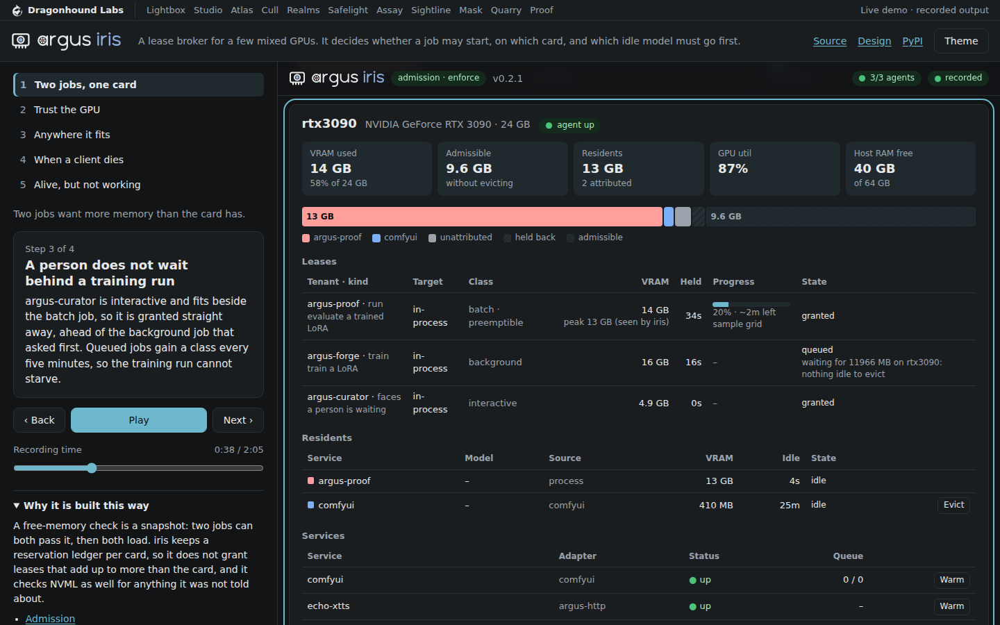

# argus-iris-demo

A guided, five-scene replay of [argus-iris](https://github.com/smk762/argus-iris), a lease broker for a few mixed GPUs.
It shows the real dashboard and the decisions of the published broker, in a static page with no server and no GPU.



| Scene | What happens |
|---|---|
| Two jobs, one card | A reservation, a queue, and an interactive job that does not wait behind a training run |
| Trust the GPU | An idle model is evicted, and the lease waits until NVML shows the memory back |
| Anywhere it fits | Work goes to another card that serves the same target |
| When a client dies | The lease expires by itself and the next job starts |
| Alive, but not working | Heartbeats without GPU work are flagged, asked to yield, then reclaimed |

## How it was recorded

- **Real:** the broker, its HTTP API, admission, eviction, the log lines and the dashboard, all from the `argus-iris`
  wheel on PyPI (the version is pinned in [pyproject.toml](pyproject.toml)). The dashboard's `app.js` and `app.css` are
  served byte for byte; `index.html` gains one stylesheet and one script.
- **Simulated:** the far side of the broker's HTTP calls ([record/world.py](record/world.py)): GPUs, models, services,
  and the clients that ask for leases. No real host, token or address is involved, and the recorder clears the
  environment before it starts.
- **Time:** scenes run on an event loop whose clock jumps to the next timer ([record/virtual.py](record/virtual.py)), so
  51 minutes record in well under a second. Lease ids are seeded. argus-iris is patched only where it reads the clock
  and draws ids.
- **Captions:** each one is raised only after the broker has done what it describes; a scene whose story does not happen
  fails to record. CI records every scene again and fails if a committed tape would change.

In the page, time runs about four times faster than life, quiet stretches are skipped, and captions pause it. The tour's
layout puts each node's leases first. Evict and Warm answer that this is a recording.

## Run it

Needs [uv](https://docs.astral.sh/uv/).

```bash
make install   # venv, and the headless browser the tests use
make serve     # http://127.0.0.1:8200
make tape      # record the scenes again
make test
make lint
```

To move to a newer argus-iris: change the pin, `uv lock`, `make tape`, and read the captions against the new behaviour.

## Deploy

[pages.yml](.github/workflows/pages.yml) builds `out/` and uploads it to Cloudflare Pages on a push to `main`. It needs the
repo secrets `CLOUDFLARE_API_TOKEN` (Pages: Edit) and `CLOUDFLARE_ACCOUNT_ID`, and the Pages project created once:
`npx wrangler pages project create argus-iris-demo --production-branch main`.

`web/vendor/dh/` is copied unchanged from <https://dragonhound.dev/brand/v1/>. MIT licensed.
